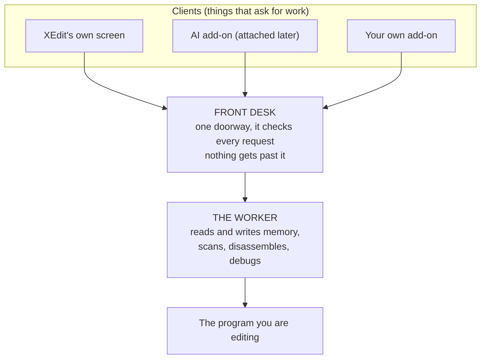
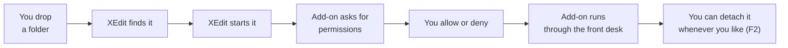
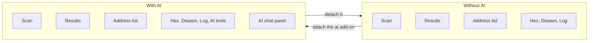
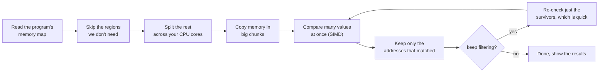
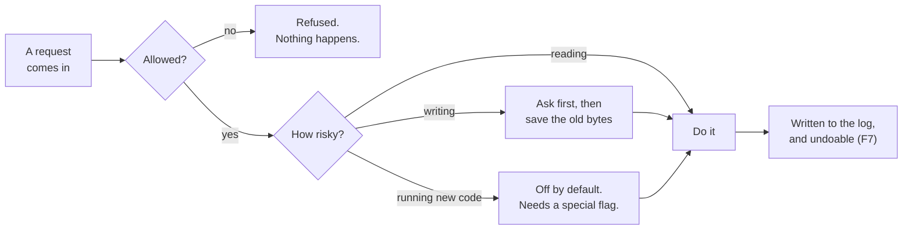

# XEdit Plan

## What is XEdit?

XEdit is a memory editor for Linux. It does what Cheat Engine does: it looks at, and
changes, the memory of a program while that program is running. You might use it on a
game, on something you are reverse engineering, or on your own code.

It is written in Rust. It runs in the terminal. It stays small and starts fast.

The one thing that makes it different: the AI is not baked into the program. It is an
add-on you attach when you want it, the same way you add an extension to a browser.
You can write your own add-ons too.

---

## How it is shaped

Think of three parts: the clients, a front desk, and a worker.



The rule is simple. Everything goes through the front desk, even XEdit's own screen.
Here is what that gives us:

- An add-on gets only the powers the desk allows, nothing extra.
- The desk writes down every request, so you can always see what an add-on did.
- XEdit's own screen uses the same door, so that door is always in use and never gets stale.

---

## The pieces in code

| Piece | Folder | What it does |
|---|---|---|
| **core** | `crates/core` | The building blocks: addresses, memory regions, settings, and the change log used for undo. No screen, no internet. |
| **engine** | `crates/engine` | The real work: attach to a program, read and write memory, scan, disassemble, debug. |
| **host** | `crates/host` | The front desk: checks permissions, starts add-ons, keeps the log. |
| **screen** | `crates/tui` | The terminal interface you actually look at. |
| **add-ons** | `addons/` | Optional extras. The AI lives here. |

Each folder has one job. That is what makes the code easy to read and easy to change.

---

## Add-ons: drop a folder, get a feature

An add-on is just a folder with a settings file and a program:

```
~/.config/xedit/addons/ai/
    addon.toml          <- what it is, and what it is allowed to do
    xedit-addon-ai      <- the program (any language)
```

You do not rebuild anything. XEdit finds the folder, starts the program, and they talk.



The settings file says what it wants up front, so nothing is hidden.

```toml
[addon]
name = "AI Agent"
version = "0.1.0"

[run]
program = "xedit-addon-ai"

[asks_for]           # the permissions it wants
keys = [
  "read memory",     # looking at memory
  "scan memory",     # searching memory
  "write memory?",   # the "?" means: ask me every single time
  "the internet",    # to reach the AI service
  "add a panel",     # to show its chat window
]
```

---

## What it looks like without AI

This is a complete tool on its own. No AI, and no internet code at all.

```
┌ XEdit ─ blockgame [pid 4821] 64-bit ─ 4.2 GB ─ addons:0 ───────────┐
├─ SCAN ─────────────┬─ RESULTS (12,481) ────────────────────────────┤
│ value [100_____]   │ ▸ 0x5c0012a40   100   i32                     │
│ type  <i32>        │   0x7ffde10aa0  100   i32                     │
│ mode  <exact>      │   ...  (scrolls smoothly even with millions)  │
├────────────────────┴───────────────────────────────────────────────┤
│ ADDRESS LIST      0x5c0012a40  i32  100  "health"                  │
├────────────────────────────────────────────────────────────────────┤
│ [HEX] [DISASM] [TRACE]   00 00 C8 42 00 00 00 00 ...               │
└────────────────────────────────────────────────────────────────────┘
 F5 scan  F6 next  F7 undo  F2 addons  ^P commands  q quit
```

You can search memory, filter the results, freeze values so they stay put, view the raw
bytes, view the assembly, undo any change, and manage add-ons.

---

## What it looks like with the AI add-on

Same program. One extra panel, a few extra commands. Nothing else changes.



```
┌ XEdit ─ blockgame [pid 4821] ─ addons: ai ▸ ─────────────────────┐
├─ SCAN ──────┬─ RESULTS ──────────┬─ AI AGENT ────────────────────┤
│ value [100] │ ▸ 0x5c0012a40 100  │ > find my health, then a      │
│ type <i32>  │   0x7ffde10aa0 100 │   pointer path that survives  │
│ mode <exact>│   ...              │   a restart                   │
│             │                    │ ● scan i32 == 100  ✓ 12,481   │
│             │                    │ ● keep the ones that dropped  │
│             │                    │   ███░░ 3/5  working...       │
├─────────────┴────────────────────┴───────────────────────────────┤
│ ADDRESS LIST     0x5c0012a40 (frozen, added by ai)               │
├──────────────────────────────────────────────────────────────────┤
│ [HEX][DISASM][TRACE][AI·TOOLS]   00 00 C8 42 ...                 │
└──────────────────────────────────────────────────────────────────┘
```

The `AI·TOOLS` tab shows every single request the AI made, so you can always check its
work. Detach the add-on and you are back to the plain tool, exactly as it was.

---

## How scanning stays fast



Two tricks do most of the work:

1. Compare many values per CPU instruction (SIMD) instead of one at a time.
2. For "unknown value" searches, only look at memory pages that actually changed, by
   comparing a fingerprint of each page first.

The goal is to scan 4 GB in under about 1.5 seconds, use under 40 MB of RAM, and open
instantly.

---

## Staying safe



The rules, in plain words:

- Reads are fine. Writes ask first, and you can always undo them with `F7`.
- Running new code (also called injection) stays off until you switch it on.
- The internet is only reachable at the address you set. There is no tracking, ever.
- Memory is data, never instructions. If some memory happens to contain text like
  "ignore your rules", the AI treats it as something to read, not something to obey.
- The AI has a step limit, and you can press `Esc` to stop it at any moment.

---

## Build order


Steps 0 through 5 give you a finished, fast tool with no AI at all. Step 8 adds the AI
by attaching one add-on.

---

## Words used in this plan

| Word | What it means here |
|---|---|
| a client | Anything asking the worker to do something: the screen, the AI, or your add-on. |
| the front desk | The single doorway everyone passes through. It checks permissions and keeps the log. |
| the worker | The part that actually reads and writes memory and runs scans. |
| an add-on | An optional extra feature in its own folder, attached while XEdit is running. |
| a permission | One specific power an add-on is allowed to use, like "write memory". |
| SIMD | Comparing many values inside one CPU instruction, which makes scanning faster. |
| a region | A chunk of a program's memory. Some is readable, some is writable, some is neither. |
| freeze | Hold a value at a number and rewrite it whenever the program changes it. |
| the log | A record of every change, so you can undo it later. |

---

## Choices we have made

- Language is Rust. The interface is the terminal for now.
- Add-ons are separate programs, attached while XEdit runs.
- The front desk is the only way in. Both add-ons and the screen use it.
- The AI is an official add-on, off by default, and works with any OpenAI style service,
  in the cloud or on your own machine.
- Speed comes from big memory reads, comparing many values at once, and using every CPU core.